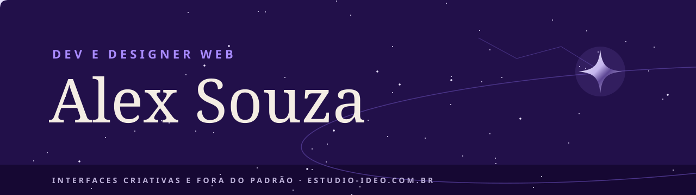

  

Oi, eu sou o Alex (ele/delu), dev e designer web. Gosto de site com personalidade: letra gótica, céu estrelado, um segredo escondido no canto da tela pra quem procurar. Como eu desenho e também programo, a ideia mais estranha do layout chega inteira no navegador, sem se perder no caminho.

Toco o [Ideo Estúdio](https://estudio-ideo.com.br), onde faço identidade visual, sites e automações com IA e n8n. Antes de abrir o Figma eu quero saber pra quem é e qual problema resolve; depois vem o código, com testes e cada medida de segurança explicada no README. Sou formado em Comunicação Visual pelo IFSC e estou cursando Análise e Desenvolvimento de Sistemas na PUCPR.

### Projetos em destaque

| Projeto | O que é |
| --- | --- |
| [Widgets Ideo](https://github.com/alexsouza-ideo/widgets-ideo) | Widgets de área de trabalho para Windows, em Tauri e Rust: relógio, tarefas, galeria, uso do PC. Arrastáveis e presos na camada dos ícones |
| [Site do Ideo Estúdio](https://github.com/alexsouza-ideo/Ideo-estudio) | Site do estúdio no tema "carta celeste", com painel de edição, formulário de orçamento e política de segurança documentada |
| [Painel de gestão](https://github.com/alexsouza-ideo/painel-de-gestao) | Sistema web do estúdio com Supabase: tarefas, posts e equipe, com login e regras de acesso testadas |

### Com o que eu trabalho

**Design** &nbsp;

**Código** &nbsp;

**Dados e automação** &nbsp;

### Agora

Estou levando o painel de gestão do estúdio pra produção e preparando os cases novos do site.

### Onde me achar

[Site e orçamento](https://estudio-ideo.com.br) · [LinkedIn](https://linkedin.com/in/alex-souza-perfil) · [Behance](https://behance.net/alexsouza82)
